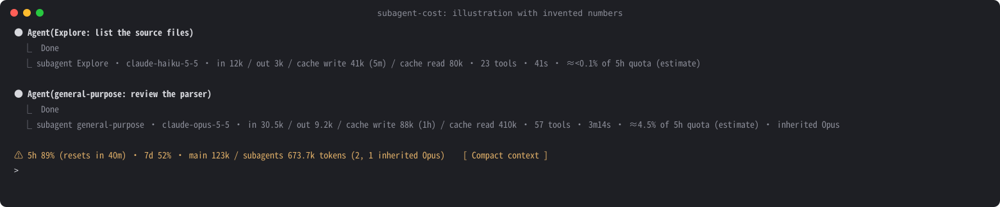

# subagent-cost

A Claude Code mod that shows what each subagent used under its tool row, keeps your 5-hour and 7-day quota above the prompt, compacts the context after a finished task, and asks Claude for a handoff brief when the quota is nearly used up.

[中文说明](README.zh-CN.md)



*Illustration, not a screenshot: the lines are produced by the mod's own formatting code, fed with invented numbers.*

## Install

At the prompt of a Claude Code terminal session:

```
/plugin install subagent-cost --marketplace keienhrri-bit/claude-subagent-cost
```

Answer `y` to add the marketplace, then pick a scope (user scope loads it in every session).

From a shell:

```bash
claude plugin install subagent-cost --marketplace keienhrri-bit/claude-subagent-cost
```

In the desktop app, where `/plugin` does not run: click **+** next to the prompt box, then **Plugins**, **Add marketplace** with `keienhrri-bit/claude-subagent-cost`, then **Add plugin**. A mod installed from a terminal at user scope also loads in the desktop app's local sessions (per Claude Code's plugin documentation).

Built and tested against the mod engine of Claude Code 2.1.325.

## What it shows

**Under each Agent tool row**, once the subagent has finished:

```
subagent Explore · claude-haiku-5-5 · in 12k / out 3k / cache write 41k (5m) / cache read 80k · 23 tools · 41s
```

Subagent type, the model it actually ran on, input / output / cache-write (with the cache lifetime, 5m or 1h) / cache-read tokens, tool calls and duration. Once the estimate below has enough data, the line ends with `≈0.8% of 5h quota (estimate)`; until then it shows tokens only.

**Above the prompt**, one line:

```
5h 63% (resets in 2h) · 7d 41% · main 123k / subagents 272k tokens (2, 1 inherited Opus)
```

The 5-hour and 7-day usage and when the 5-hour window resets, tokens used by the main session and by its subagents, how many subagents ran, and how many of them inherited an expensive model. When Claude Code reports no usage windows, the line shows tokens only.

**A notice when a subagent inherits Opus, Fable or Mythos.** A subagent called without a `model` runs on whatever its own definition names, or on the main session's model when its definition names none. If that is an expensive model, a toast says so and how to avoid it.

## What it does

### Compaction after a finished task

After a turn that ended with an answer, if the context has reached 60% of the window or 150,000 tokens (whichever comes first), the mod compacts it, with instructions to keep decisions made, key file paths, the work in progress and open questions verbatim.

It does not compact when:

- the turn ended with a question to you: the last line ends in `?` or `？`, or the turn called `AskUserQuestion` (this is a heuristic);
- a background agent or task is still running;
- the turn was interrupted;
- usage is past the handoff threshold (the brief comes first);
- a previous compaction left the context large and it has grown less than 20,000 tokens since.

In a session that the desktop app or the Agent SDK runs, Claude Code does not yet let a mod compact between turns; there the mod queues a `/compact` with the same instructions instead, which runs as a turn of its own.

`autoCompact: ask` shows a **Compact context** button on the quota line instead. `off` turns this off. If another mod or setting of yours also compacts automatically, turn one of them off.

### Quota warnings and the handoff brief

- At **88%** of the 5-hour window, the quota line turns into a warning and you get one toast.
- At **90%**, Claude is asked to write a handoff brief to `HANDOFF.md` (relative to the session's folder) with these sections: Goal, Decisions made, Done, In progress, Next steps, Key files, Open questions, and to start no new large task in this window.

Each fires once per window. The 7-day window has its own thresholds (also 88 / 90 by default). Below the thresholds the warnings add nothing to the conversation and spend no tokens.

How the request reaches Claude: during a turn, it is attached to the next tool result; between turns, it is added to the conversation as a message. In our test, a request added between turns was acted on with your next message, not before it.

### Subagent model policy

`subagentModelPolicy` is `warn` (the default: the toast above), `off`, or `downgrade:<model>`, for example `downgrade:sonnet`.

With `downgrade`, the mod passes `<model>` for subagents of a type that it has already seen running on the main session's model, while the main session is on Opus, Fable or Mythos. It learns this per subagent type, and remembers it across sessions:

- The first spawn of a type is never changed; if it inherited, a toast says that later ones will run on `<model>`.
- A type whose definition names its own model (Explore on Haiku, for instance) is left alone.
- A type whose definition names the same model as the main session counts as inheriting.
- A `model` passed in the call is always kept. Forks are never changed.
- It learns only from spawns it did not rewrite while the main session was on Opus, Fable or Mythos (under `warn` or `off`, or before a type is known). Spawns under a cheaper main model teach it nothing, since a type with Haiku of its own looks the same as one that inherits Haiku.

## Settings

Set these when you install, or later from the plugin's settings.

| Option | Default | What it does |
| --- | --- | --- |
| `language` | `en` | Language of the lines and toasts: `en` or `zh`. |
| `subagentModelPolicy` | `warn` | `warn`, `off` or `downgrade:<model>`, as above. |
| `autoCompact` | `auto` | `auto`, `ask` or `off`. |
| `compactAtPercent` | `60` | Context fill, in percent, that counts as large. `0` turns this test off. |
| `compactAtTokens` | `150000` | Context tokens that count as large. `0` turns this test off. |
| `warnAt` | `88` | 5-hour percent for the warning. |
| `handoffAt` | `90` | 5-hour percent for the handoff brief. |
| `warnAt7d` | `88` | 7-day percent for the warning. |
| `handoffAt7d` | `90` | 7-day percent for the handoff brief. |
| `handoffPath` | `HANDOFF.md` | Where the brief goes; relative to the session's folder. |

## How the "% of 5h quota" estimate works

The percentage on a subagent line is an estimate, and its error has not been measured.

1. Every response's tokens (main loop and each subagent, from Claude Code's per-turn usage) are weighted by the Anthropic API list price of the model that produced them: input, output, cache write (1.25× input for a 5-minute cache, 2× for a 1-hour one) and cache read. The prices come from the Claude API reference bundled with Claude Code 2.1.325. Only the ratios between models and token kinds matter; nothing is shown in dollars.
2. The mod reads the 5-hour usage percentage that Claude Code reports. Once that percentage has moved by at least 2 points since a baseline, the mod divides the change by the weighted spend over the same stretch, which gives "percent per unit of weighted spend".
3. A subagent's share is its weighted spend times that rate.

This assumes:

- **One session on the account.** Other sessions, other devices or claude.ai use move the same percentage, so the rate comes out too high and every share with it.
- **List-price ratios match how the plan counts usage.** Anthropic does not publish how plan usage is computed; if the ratios differ, shares are off by the same factor.
- **Main-loop cache writes are priced as 5-minute writes.** For subagents the split between 5-minute and 1-hour writes comes from the Agent tool result; for the main loop it is not available to the mod.
- **The percentage is coarse.** With a 2-point move, rounding alone can shift the rate by tens of percent.

Treat the share as an order of magnitude: useful to see that one subagent cost ten times another, not to tell 0.8% from 1.1%.

## What it keeps and what it reads

- Per session (Claude Code's plugin state): the rows, the token totals, the latest usage readings, the estimate's baseline and rate, which warnings have fired.
- Across sessions (the plugin's own store): for each subagent type, whether it was seen inheriting the main model (`inherits:<type>`).
- It reads only what Claude Code passes to mods, and makes no network requests of its own. It reads no credentials.
- The only file it writes is its own store, through Claude Code's `$.store`. The handoff brief is written by Claude, not by the mod.
- It changes the conversation in two ways only: the compaction, and the handoff request it adds.

## Compared with similar tools

As of 2026-11-16. Descriptions are taken from each project's own README or repository description; follow the link to check.

| Project | Kind | What it does |
| --- | --- | --- |
| `/usage` (built into Claude Code) | command | Shows plan usage when you run it. |
| [claude-code-usage-quota-mod](https://github.com/anantraghunath/claude-code-usage-quota-mod) | mod | Live band above the prompt: 5-hour and weekly usage with a forecast against the resets, context use, a one-click Compact, and per-session auto compact (30% by default). |
| [usage-budget](https://github.com/erikdarlingdata/claude-plugins) (in erikdarlingdata/claude-plugins) | mod | Toasts as the 5-hour and 7-day windows fill (70 / 85 / 95 by default), a note to the model from 85% so it can wrap up and write its handoff, refuses new subagents from 95%, and paces the 7-day window. |
| [subagent-band](https://github.com/erikdarlingdata/claude-plugins) (same repository) | mod | A band of running subagents with type, model, effort, steps, context, advisor calls and estimated cost in dollars; a `/fleet` pane and a `/subagent-cost` command (a command name that matches this mod's name; this mod adds no commands). |
| [claude-flightdeck](https://github.com/scasella/claude-flightdeck) | mod | A live agent dashboard in the terminal: context and cost, advisor timeline, permission checks, subagent cards and swimlanes. |
| [claude-agent-tree](https://github.com/pedrowillen/claude-agent-tree) | mod | A live Agents pane with the orchestrator and subagent tree: model, effort, tokens, tools, duration and reply preview. |
| [agent-usage-guard](https://github.com/rbartoli/agent-usage-guard) | mod | Holds subagent fan-out, heavy-context prompts and retry loops before they spend the usage window; reads the plan's usage, counts agents across sessions, and asks in Claude Code's own dialog. |
| [claude-handoff-revive](https://github.com/sofumel/claude-handoff-revive) | plugin | Saves a handoff automatically at 90% / 95% usage and resumes work after a limit without replaying the transcript; 10 languages. |
| [claude-code-usage-bar](https://github.com/leeguooooo/claude-code-usage-bar) | status line | 5-hour / 7-day usage, reset countdowns, model, context window and prompt-cache age in one line. |

Where this mod differs: it puts each finished subagent's token split and actual model under that subagent's own row; it states usage as a share of the 5-hour window rather than in dollars, and labels that share as an estimate; it compacts only after a turn that ended with an answer; it writes the handoff to a file with fixed sections; and it never refuses a subagent. It has no forecast, no pane and no dashboard.

A status-line tool draws in a terminal session. We have not checked whether the desktop app's Code tab runs a custom status line; our guess is that it does not, in which case those tools show nothing there. A mod's rows are drawn for the desktop app according to Claude Code's plugin documentation; we have not checked that on screen either.

## What has been tested, and what has not

As of v0.1.0. The unit and engine tests pass (34 tests, `claude plugin test`). Beyond those, the mod was run in throwaway headless sessions (`claude -p` with `--plugin-dir`, Claude Code 2.1.325, Haiku as the main model), with low thresholds set for the test. There:

- the 5-hour percentage and its reset time arrived from Claude Code;
- at the handoff threshold the toast fired, the request was added between turns, and with the next message Claude wrote the brief with the seven sections;
- no compaction followed a turn that ended with a question, or a turn while a background subagent ran; after a turn that answered, the queued `/compact` ran and the context went from 28,180 to 7,090 tokens;
- a background Explore subagent's usage was reported apart from the main loop's, and the main loop's turn did not include it;
- the per-type record was written to the plugin's store.

Not tested:

- **Drawing.** Headless sessions draw nothing, so the subagent row, the quota line and the button have not been seen on screen, in the terminal or in the desktop app.
- **Compaction between turns in an interactive terminal session** (the direct path, not the queued `/compact`).
- **The estimate.** Its error is unknown (see above), and no test session moved the 5-hour percentage the 2 points needed for a rate.
- **A subagent that is not backgrounded**, where tool count and duration come from the Agent result.
- **The question heuristic** can miss a question that does not end in a question mark, and can treat a rhetorical last line as a question.

## Related

By the same author:

- [claude-code-usage-audit](https://github.com/keienhrri-bit/claude-code-usage-audit): a usage ledger across sessions and days, read from local Claude Code and Codex logs, showing where the usage went.
- [agent-cite-check](https://github.com/keienhrri-bit/agent-cite-check): checks an agent's report against your local files (quoted lines, numbers, changed files), without calling a model.

## License

MIT. See [LICENSE](LICENSE).
