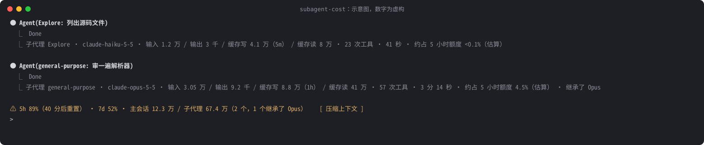

# subagent-cost

一个 Claude Code mod：在每个子代理的工具行下面列出它用了多少 token，在输入框上方显示 5 小时和 7 天额度，任务做完后压缩上下文，额度快用完时让 Claude 写交接任务书。

[English](README.md)



*示意图，不是截图：文字由 mod 自己的格式化代码生成，数字是虚构的。*

## 安装

在 Claude Code 终端会话的输入框里：

```
/plugin install subagent-cost --marketplace keienhrri-bit/claude-subagent-cost
```

先按 `y` 添加 marketplace，再选范围（选 user 范围，之后每个会话都会加载）。

在命令行里：

```bash
claude plugin install subagent-cost --marketplace keienhrri-bit/claude-subagent-cost
```

桌面版里 `/plugin` 用不了：点输入框旁边的 **+**，选 **Plugins**，再选 **Add marketplace**，填 `keienhrri-bit/claude-subagent-cost`，然后选 **Add plugin**。按 Claude Code 插件文档的说法，在终端里装到 user 范围的 mod，桌面版的本地会话也会加载。

按 Claude Code 2.1.325 的 mod 引擎编写和测试。

## 显示什么

**每个 Agent 工具行下面**，子代理跑完以后显示一行：

```
子代理 Explore · claude-haiku-5-5 · 输入 1.2 万 / 输出 3 千 / 缓存写 4.1 万（5m） / 缓存读 8 万 · 23 次工具 · 41 秒
```

依次是子代理类型、实际用的模型、输入 / 输出 / 缓存写（括号里是缓存时长，5m 或 1h）/ 缓存读 token、工具调用次数、用时。下面的估算攒够数据以后，行尾会加上 `约占 5 小时额度 0.8%（估算）`；数据不够时只显示 token。

在后台运行的子代理不会返回带这些合计的 Agent 结果：它的工具调用次数由 mod 自己数，这一行也不显示缓存时长。用消息（SendMessage）让子代理接着干活时，它会用同一个 id 再跑一次；这一次的 token、工具次数和用时加到它原来那一行上。

**输入框上方**一行：

```
5h 63%（2 小时后重置） · 7d 41% · 主会话 12.3 万 / 子代理 27.2 万（2 个，1 个继承了 Opus）
```

依次是 5 小时和 7 天的已用比例、5 小时窗口多久后重置、主会话和子代理各用了多少 token、跑了几个子代理、其中几个继承了贵的模型（不止一种时写成 `Opus/Fable`）。Claude Code 没有报额度窗口时，这一行只显示 token；重置时间已经过了的读数不再显示，等新的读数。

**子代理继承了 Opus、Fable 或 Mythos 时弹提示。** 调用子代理时没传 `model`，它就用自己定义里写的模型；定义里也没写，就沿用主会话的模型。如果沿用的是贵的模型，会弹一条提示，说明怎么避免。

## 做什么

### 任务做完后压缩

一轮对话以回答结束后，如果上下文已经占到窗口的 60%，或者到了 15 万 token（先到哪个算哪个），mod 会压缩上下文，并要求压缩时原样保留已经做出的决定、关键文件路径、进行中的工作和等你回答的问题。

以下情况不压缩：

- 这一轮以向你提问结束：最后一行以 `?` 或 `？` 结尾，或者这一轮调用了 `AskUserQuestion`（这是经验判断，见“没验证的”）；
- 还有后台子代理或任务在跑；
- 这一轮被中断了；
- 额度已经过了交接线（先写交接）；
- 上一次压缩后上下文仍然很大，而且之后增长不到 2 万 token。

由桌面版或 Agent SDK 运行的会话里，Claude Code 暂时不让 mod 在两轮之间直接压缩；这时 mod 会改为排一条带同样要求的 `/compact`，它作为单独一轮运行。

`autoCompact` 设成 `ask` 时不自动压缩，改为在额度行上显示 **压缩上下文** 按钮；设成 `off` 则关闭。如果你装的其他 mod 或设置也会自动压缩，关掉其中一个。

### 额度提醒和交接任务书

- 5 小时额度用到 **88%**：额度行变成警告样式，并弹一次提示。
- 用到 **90%**：请 Claude 把交接任务书写到 `HANDOFF.md`（相对会话所在目录），分这几节：目标、已做的决定、已完成、进行中、下一步、关键文件、待定问题；并且在这个窗口里不再开新的大任务。

每个窗口各触发一次。7 天窗口的阈值单独设置（默认也是 88 / 90）；两个窗口同时到线，或者一个窗口的请求还没送出去另一个也到线了，Claude 收到的是一条同时写明两个窗口的请求。前后两个窗口靠重置时间区分；Claude Code 没报重置时间时，靠已用比例跌到提醒线的一半以下来区分。没到阈值时，提醒功能不往对话里加任何东西，不花 token。

请求怎么送到 Claude：一轮进行中时，附在下一个工具结果里；两轮之间时，作为一条消息加进对话。我们的测试里，两轮之间加进去的请求，是在你发下一条消息时才处理的，没有提前处理。

### 子代理模型策略

`subagentModelPolicy` 可以是 `warn`（默认，就是上面的提示）、`off`，或 `downgrade:<模型>`，比如 `downgrade:sonnet`。

设成 `downgrade` 后，如果主会话在用 Opus、Fable 或 Mythos，而某类子代理已经被看到沿用了主会话的模型，之后这类子代理调用时 mod 会替它传 `<模型>`。是否沿用按子代理类型分别记录，跨会话保留：

- 每类子代理的第一次调用不改；如果它沿用了主模型，会弹提示说之后的同类子代理会改用 `<模型>`。
- 被看到时定义里写了自己模型的类型（比如用 Haiku 的 Explore）不动。
- 定义里写的模型恰好和主会话相同的类型，算作沿用。
- 调用时传了 `model` 的一律保留。fork 不改。
- 只从主会话在用 Opus、Fable 或 Mythos、且 mod 没有改写的调用里学习（即 `warn` 或 `off` 下，或某类型还没记录时）。主会话用便宜模型时的调用不算数：自带 Haiku 的类型和沿用 Haiku 的类型这时看起来一样。
- Claude Code 不告诉 mod 某个类型的定义里写了什么模型，所以你改了定义，要等这个类型再被看到一次才会发现。对一个类型的记录保留 7 天；过期后，这个类型的下一次调用不改写，重新学习。想马上重新学习（比如刚给某个 agent 加了自己的 `model`）：把策略设成 `warn`，在 Opus、Fable 或 Mythos 主会话里调用一次这类子代理，再改回来。

## 设置

安装时可以设，之后也可以在插件设置里改。

| 选项 | 默认值 | 作用 |
| --- | --- | --- |
| `language` | `en` | 提示和行内文字的语言：`en` 或 `zh`。 |
| `subagentModelPolicy` | `warn` | `warn`、`off` 或 `downgrade:<模型>`，见上。 |
| `autoCompact` | `auto` | `auto`、`ask` 或 `off`。 |
| `compactAtPercent` | `60` | 上下文占窗口多少百分比算大。`0` 关掉这一项。 |
| `compactAtTokens` | `150000` | 上下文多少 token 算大。`0` 关掉这一项。 |
| `warnAt` | `88` | 5 小时窗口的提醒线（百分比）。 |
| `handoffAt` | `90` | 5 小时窗口的交接线（百分比）。 |
| `warnAt7d` | `88` | 7 天窗口的提醒线（百分比）。 |
| `handoffAt7d` | `90` | 7 天窗口的交接线（百分比）。 |
| `handoffPath` | `HANDOFF.md` | 交接任务书写到哪；相对会话所在目录。 |

## “占 5h 额度百分比”怎么估算

子代理行上的百分比是估算值，误差没有测过。

1. 每次回复的 token（主会话和各个子代理，取自 Claude Code 每轮报的用量）按产生它的模型在 Anthropic API 的标价加权：输入、输出、缓存写（5 分钟缓存按输入价的 1.25 倍，1 小时缓存按 2 倍）、缓存读。价格取自 Claude Code 2.1.325 自带的 Claude API 参考资料。只用到不同模型、不同 token 之间的价格比例，不显示美元金额。
2. mod 读取 Claude Code 报的 5 小时已用百分比。从某个基准点起，这个百分比涨了至少 2 个点以后，mod 用涨幅除以同一段时间的加权花费，得到“每单位加权花费对应多少百分点”。
3. 子代理的占比 = 它的加权花费 × 这个比率。

前提是：

- **账号上只开了这一个会话。** 其他会话、其他设备或 claude.ai 的使用也会推高同一个百分比，比率就会偏高，每个占比都跟着偏高。
- **标价比例和套餐的用量算法一致。** Anthropic 没有公开套餐用量的算法；比例不一致的话，占比会按同一倍数偏差。
- **缓存写的拆分只有一个来源。** 子代理的 5 分钟和 1 小时缓存写各占多少，取自 Agent 工具的结果，而这个结果报的是这一次运行的最后一个请求；mod 把它套用到整次运行。每次运行结束时按它自己的模型计价，后一次运行不会改前一次的价。主会话和拿不到拆分的子代理运行（包括后台运行及 SendMessage 续跑）的缓存写按 5 分钟估价。累计写入包含时长未知的部分时，该行省略缓存时长。
- **百分比本身很粗。** 只涨 2 个点时，光是取整就可能让比率偏差几十个百分点。

把这个占比当数量级看：能看出一个子代理花的是另一个的十倍，分不清 0.8% 和 1.1%。

## 存了什么，读了什么

- 每个会话内（Claude Code 的插件状态）：各行数据、token 合计、最近的额度读数、估算的基准和比率、哪些提醒已经弹过。
- 跨会话（插件自己的存储）：每类子代理是否被看到沿用主模型，以及什么时候看到的（`inherits:<类型>`）。
- 只读 Claude Code 交给 mod 的数据，自己不发网络请求，不读凭据。
- 唯一会写的文件是它自己的存储（通过 Claude Code 的 `$.store`）。交接任务书由 Claude 写，不是 mod 写。
- 对对话只做两种改动：压缩，以及加进去的交接请求。

## 和同类工具的区别

截至 2026-11-16。描述取自各项目自己的 README 或仓库简介，可以点链接核对。

| 项目 | 形式 | 做什么 |
| --- | --- | --- |
| `/usage`（Claude Code 自带） | 命令 | 运行时显示套餐用量。 |
| [claude-code-usage-quota-mod](https://github.com/anantraghunath/claude-code-usage-quota-mod) | mod | 输入框上方的实时条：5 小时和每周用量、按重置时间预测、上下文用量、一键压缩，以及按会话的自动压缩（默认 30%）。 |
| [usage-budget](https://github.com/erikdarlingdata/claude-plugins)（在 erikdarlingdata/claude-plugins 里） | mod | 5 小时和 7 天窗口涨到一定比例时弹提示（默认 70 / 85 / 95），从 85% 起提醒模型收尾、写交接，从 95% 起拒绝新子代理，并对 7 天窗口做配速。 |
| [subagent-band](https://github.com/erikdarlingdata/claude-plugins)（同一仓库） | mod | 一条列出运行中子代理的条：类型、模型、effort、步数、上下文、advisor 调用、估算美元成本；有 `/fleet` 面板和 `/subagent-cost` 命令（命令名和本 mod 同名；本 mod 不加命令）。 |
| [claude-flightdeck](https://github.com/scasella/claude-flightdeck) | mod | 终端里的实时 agent 面板：上下文和成本、advisor 时间线、权限检查、子代理卡片和泳道图。 |
| [claude-agent-tree](https://github.com/pedrowillen/claude-agent-tree) | mod | 实时的 Agents 面板，显示主会话和子代理组成的树：模型、effort、token、工具、用时和回复预览。 |
| [agent-usage-guard](https://github.com/rbartoli/agent-usage-guard) | mod | 在子代理扇出、大上下文提示和重试循环花掉额度窗口之前拦下来；读取套餐用量，跨会话统计子代理数，并用 Claude Code 自带的对话框询问。 |
| [claude-handoff-revive](https://github.com/sofumel/claude-handoff-revive) | 插件 | 用量到 90% / 95% 时自动保存交接，撞限额后不重放记录就能接着做；10 种语言。 |
| [claude-code-usage-bar](https://github.com/leeguooooo/claude-code-usage-bar) | 状态栏 | 一行里显示 5 小时 / 7 天用量、重置倒计时、模型、上下文窗口和提示缓存的存活时间。 |

本 mod 的不同之处：把每个跑完的子代理的 token 拆分和实际模型放在它自己的工具行下面；用量按占 5 小时窗口的比例给，不折成美元，并标明是估算；只在以回答结束的一轮之后压缩；交接写进固定分节的文件；从不拒绝子代理。它没有预测、没有面板，也没有仪表盘。

状态栏类工具画在终端会话里。我们没有确认桌面版的 Code 标签页会不会运行自定义状态栏，推测不会；如果确实不会，这类工具在桌面版里就看不到。按 Claude Code 插件文档的说法，mod 的行会在桌面版里画出来；我们在终端会话的屏幕上看到过本 mod 的行，桌面版里没有看过。

## 测过什么，没测什么

v0.1.2 的 64 个单元和引擎测试均已通过（`claude plugin test`）。下文的实测记录来自用 `--plugin-dir` 新开的一次性会话（Claude Code 2.1.325，主模型 Haiku，阈值按测试需要设置）。

在 v0.1.1 上跑的：

- **交互式终端会话的屏幕上。** 后台 Explore 子代理在跑时，它那一行下面显示 `subagent Explore · claude-haiku-5-5 · usage pending`；跑完后变成 `subagent Explore · claude-haiku-5-5 · in 4 / out 508 / cache write 21.1k / cache read 20.1k · 2 tools · 5s`，其中工具次数是 mod 自己数的。输入框上方那一行显示了 5 小时和 7 天的比例、5 小时重置时间和 token 合计，Claude Code 自己的提示照常显示。
- **两个窗口同时到线**（无界面会话，两条交接线都设成 1%）：Claude 收到一条同时写明两个窗口的请求，附在下一个工具结果里，并写好了交接任务书。
- **不在后台运行的子代理：** Agent 结果里的工具次数（3）和 mod 自己数的一致。
- 两次的调试日志里，本 mod 的 hook 都没有被跳过或拒绝。

沿用 v0.1.0 无界面实测的结果：

- 5 小时已用比例和重置时间能从 Claude Code 正常读到；
- 到交接线时弹了提示，请求在两轮之间加进了对话，Claude 在下一条消息时按七节写好了交接任务书；
- 以提问结束的一轮之后没有压缩，后台子代理在跑时也没有压缩；以回答结束的一轮之后，排队的 `/compact` 正常运行，上下文从 28,180 token 降到 7,090 token；
- 后台 Explore 子代理的用量单独报出，主会话那一轮的用量里不含它；
- 按类型的记录写进了插件自己的存储。

没测的：

- **桌面版的显示。** 只看了终端；**压缩上下文** 按钮（`autoCompact: ask`）在哪里都还没在屏幕上看过。
- **交互式终端会话里两轮之间的直接压缩**（不经过排队的 `/compact` 的那条路）。
- **估算。** 误差不知道（见上）。有一次测试会话里 5 小时比例涨了 2 个点，算出了比率，但当时同一账号上还有别的会话在用，所以那个比率偏高。
- **用 SendMessage 接着跑的子代理，以及子代理类型 7 天后的重新学习：** 只有单元测试。
- **判断“以提问结束”的规则**会漏掉不以问号结尾的提问，也可能把反问句当成提问。

## 相关工具

同一作者的其他工具：

- [claude-code-usage-audit](https://github.com/keienhrri-bit/claude-code-usage-audit)：跨会话、跨天的历史用量账，从本地 Claude Code 和 Codex 日志里看用量花在了哪里。
- [agent-cite-check](https://github.com/keienhrri-bit/agent-cite-check)：不调用模型，把 Agent 回报里的引文、数字和改动逐条对回本地文件。

## 许可

MIT，见 [LICENSE](LICENSE)。
